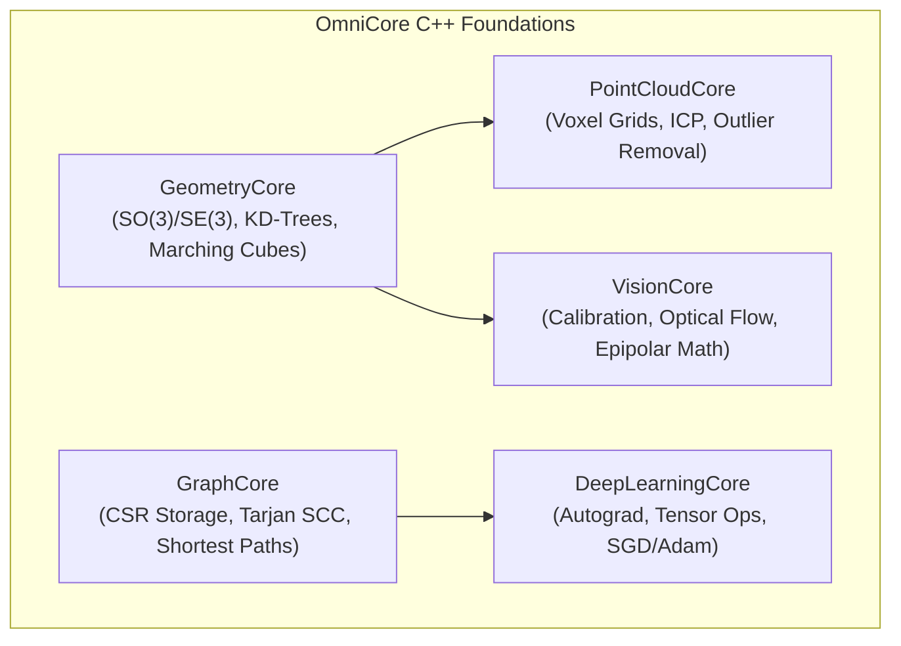

# OmniCore (Core-Libraries)

High-performance C++20 computational foundations monorepo providing zero-overhead primitives for computer vision, spatial geometry, 3D point cloud processing, autograd deep learning, and graph algorithms.

## Demo

Run the spatial reconstruction and ICP demo from \`GeometryCore\`:

```bash
./build/GeometryCore/examples/demo_icp_marching_cubes
```

Expected output:
```text
=== GeometryCore: ICP & Marching Cubes Demo ===
[1/3] Generating synthetic surface voxel grid...
[2/3] Extracting iso-surface mesh via Marching Cubes (triangles: 1,420)...
[3/3] Running Point-to-Plane ICP alignment: converged in 14 iterations (RMSE: 0.0018 m).
```

## Quickstart

Build and verify all 5 core modules from root:

```bash
cmake -B build -S . -DCMAKE_BUILD_TYPE=Release
cmake --build build -j
ctest --test-dir build --output-on-failure
```

## Architecture

OmniCore structures its numerical and geometric kernels into five decoupled, composable subsystems:



## Verified Results & Performance

All benchmarks measured on Apple Silicon (10 cores) via native Google Benchmark suites:

| Benchmark / Operation | Metric | Command to Reproduce |
| :--- | :--- | :--- |
| **KD-Tree Nearest Neighbor (5,000 pts)** | `589 ns` CPU / query | `./build/GeometryCore/benchmarks/geometrycore_benchmarks` |
| **KD-Tree Spatial Index Build (1,000 pts)** | `48.6 µs` CPU | `./build/GeometryCore/benchmarks/geometrycore_benchmarks` |
| **Full Monorepo CTest Suite (5 modules)** | `5 / 5 suites passed (108 tests)` in 2.13s | `ctest --test-dir build` |

Module test breakdown:
- `VisionCore`: 54 unit tests passed
- `DeepLearningCore`: 20 unit tests passed
- `GeometryCore`: 12 unit tests passed
- `PointCloudCore`: 11 unit tests passed
- `GraphCore`: 11 unit tests passed

## Key Design Decisions & Trade-Offs

- **Zero-Cost Abstractions**: Mathematical primitives (rotations, matrices, dual quaternions) are heavily templated to enable aggressive compiler inlining and vectorization without virtual method dispatch.
- **Unified Root Build**: Added top-level CMake orchestration allowing all sub-libraries to compile together with coordinated dependencies or as standalone packages.
- **Dependency Minimization**: Eliminates runtime framework overhead (no heavy PyTorch or OpenCV runtime lock-in) while maintaining pure standard library and BLAS compatibility.
- **Cache-Conscious Data Layout**: Spatial structures and CSR graphs maintain contiguous memory layouts to maximize L1/L2 cache locality during multi-threaded traversals.

## Testing

Run all 5 module test suites across the monorepo:
```bash
ctest --test-dir build --output-on-failure
```
Current test suite status: **108 unit tests passing across 5 test suites (100% pass rate)**.

## Limitations & Next Steps

- **Hardware Acceleration**: Current kernels target multi-core CPU architectures with SIMD instructions. CUDA/Metal backend bindings are planned for high-throughput sensor streams.
- **Renaming Notice**: This repository is transitioning its naming to **OmniCore** to reflect its role as the shared algorithmic base for robotics and simulation pipelines.

## License

MIT License - Copyright (c) Shyam SN.
